<p align="center">
  
</p>

  

The second lessons app moves from layouts to **data and device features**: a contacts book on raw SQLite that can call and text the people in it, an SMS broadcast receiver, and an Instagram-style app shell with five tabs.

## Features

- **Contacts book** — add contacts through a dialog, stored in SQLite (name, age, address, phone)
- **Swipe actions** on contacts with `ItemTouchHelper`
- **Call and SMS straight from the list** — `ACTION_CALL` and `SmsManager.sendTextMessage`, each guarded by a runtime-permission check
- **SMS receiver** — a `BroadcastReceiver` registered for incoming messages
- **Instagram shell** — Home, Search, Add, Reels and Profile fragments behind a bottom navigation bar, with a splash screen
- **Navigation component** demo with two fragments

## How it works

### Database layer
`MySQLiteHelper` creates the schema:

```sql
create table contacts (id integer primary key autoincrement, name text, age integer, address text, phone text);
```

`MyDbManager` wraps it with `insert`, `fetch`, `update` and `delete`, so the activity never touches SQL directly. The list is reloaded in `onResume()` so edits always show up.

### Permissions
Calling and texting are dangerous permissions, so `checkCallPermission()` / `checkSmsPermission()` request them at runtime and only then perform the action.

## Project structure

```
com.example.mylesson2
├── FirstFragment.kt
├── MainActivity.kt
├── SecondFragment.kt
├── bottomNavigation/
│   ├── AddFragment.kt
│   ├── HomeFragment.kt
│   ├── InstagramMainActivity.kt
│   ├── ProfileFragment.kt
│   ├── ReelsFragment.kt
│   ├── SearchFragment.kt
│   ├── SplashActivity.kt
├── database/
│   ├── ContactAdapter.kt
│   ├── ContactModel.kt
│   ├── MyDbManager.kt
│   ├── MySQLMainActivity.kt
│   ├── MySQLiteHelper.kt
├── sms/
│   ├── SMSMainActivity.kt
│   ├── SmsReceiver.kt
```

<sub>17 source files · 440 lines of code · 14 layouts</sub>

## Tech stack

| | |
|---|---|
| **Language** | Kotlin |
| **UI** | XML layouts, View Binding |
| **Min / Target SDK** | 24 / 34 |
| **Navigation component** | Screen navigation |

## Getting started

```bash
git clone https://github.com/rajabbov/MyLesson2.git
```

1. Open the folder in **Android Studio** (Ladybug or newer).
2. Let Gradle sync.
3. Complete the configuration below, then run the `app` configuration.

### Configuration

Uses `CALL_PHONE`, `SEND_SMS` and `BROADCAST_SMS`. Grant them when prompted; on an emulator, calls and SMS go to the emulator's virtual phone.

## Known limitations

- The SMS receiver currently only logs incoming messages.

---

Made by **Ibrohimjon Rajabboyev** · [@rajabbov](https://github.com/rajabbov)
